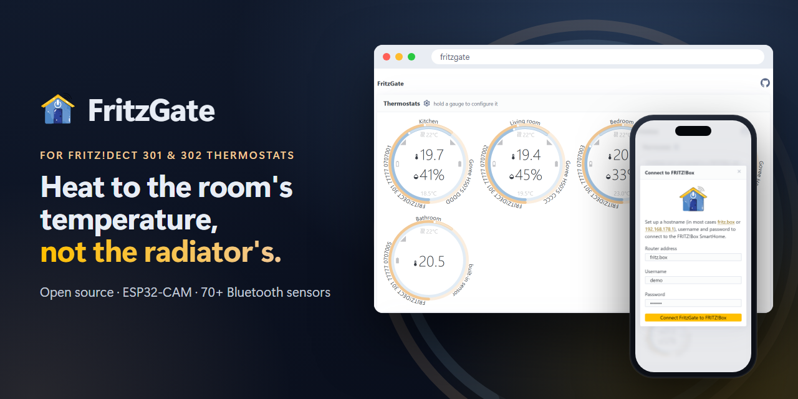

# FritzGate

**FritzGate** sorgt dafür, dass deine Heizkörperthermostate **FRITZ!DECT 301** und **FRITZ!DECT 302** nach der Temperatur im Raum heizen und nicht nach der Temperatur am Heizkörper. Es läuft auf einem kleinen, günstigen Board, dem **Ai Thinker ESP32-CAM**, und nutzt Bluetooth-Thermometer, die du in deinen Räumen aufstellst. Unterstützt werden über 70 Modelle, unter anderem von Xiaomi, Govee, SwitchBot, Qingping, Ruuvi, Inkbird und ThermoPro.

**[Website](https://fritzgate.elebree.com/)** · **[Live-Demo](https://fritzgate.elebree.com/demo/)** · **[Web-Installer](https://fritzgate.elebree.com/flasher/)**

<a href="https://fritzgate.elebree.com/demo/">
  <picture>
    <source media="(prefers-color-scheme: dark)" srcset="site/assets/social.png">
    
  </picture>
</a>

## Warum FritzGate

Ein Heizkörperthermostat misst die Temperatur direkt neben dem heißen Heizkörper, nicht im Raum, in dem du dich aufhältst. Räume werden zu warm, Ecken bleiben kalt, und du bezahlst für Wärme, die du nie spürst. Mit FritzGate folgt jedes Thermostat einem Thermometer im Raum, damit der Raum die eingestellte Temperatur erreicht.

## Was du bekommst

- **Angenehme Räume:** Die eingestellte Temperatur wird dort gemessen, wo du dich aufhältst, nicht am Heizkörper.
- **Deine Einstellungen bleiben, wie sie sind:** FritzGate ändert weder deine Wochenpläne noch andere FRITZ!Box-Einstellungen. Es ändert nur den *Temperatur-Offset* jedes Thermostats, einen Korrekturwert, den du auch selbst in der FRITZ!Box einstellen könntest.
- **Eine Webseite statt einer App:** Öffne FritzGate in einem beliebigen Browser in deinem Heimnetz. Du siehst Temperatur, Luftfeuchtigkeit, Batterie und Signal deiner Sensoren und wählst, welchem Sensor jedes Thermostat folgt. Probier die [Live-Demo](https://fritzgate.elebree.com/demo/) aus. Sie simuliert eine FRITZ!Box, daher funktioniert jedes Passwort.
- **Bleibt zu Hause:** Keine Cloud, kein Konto und kein Abo. Dein FRITZ!Box-Login wird nur auf dem Board gespeichert.
- **Günstig und aufgeräumt:** Board und Sensor kosten zusammen meist weniger als 20 €. Der USB-Anschluss der FRITZ!Box kann das Board mit Strom versorgen, du brauchst also kein eigenes Netzteil.
- **Auch ohne FRITZ!Box nutzbar:** Ohne FRITZ!Box zeigt FritzGate weiterhin die Messwerte deiner Sensoren an.

## Funktionsweise

Alle 30 Sekunden vergleicht FritzGate die Temperatur, die jedes Thermostat misst, mit der Temperatur des Raumsensors, den du dafür gewählt hast. Dann passt es den Offset des Thermostats an, damit die FRITZ!Box heizt, bis der Raum warm genug ist. FritzGate lässt den Offset unverändert, solange die Heizung aus ist oder der Sensor sich 5 Minuten lang nicht gemeldet hat.

## Was du brauchst

- Ein **Ai Thinker ESP32-CAM** Board mit einem **ESP32-CAM-MB** USB-Adapter. Das Board hat selbst keinen USB-Anschluss, und beides wird oft zusammen verkauft.
- Ein USB-Datenkabel. Manche Kabel liefern nur Strom und funktionieren für die Installation nicht.
- Mindestens ein [unterstütztes Bluetooth-Thermometer](#kompatible-sensoren).
- Eine **FRITZ!Box** mit FRITZ!DECT 301 oder 302 Thermostaten.
- Für die Installation einen Computer mit **Chrome** oder **Edge** (Windows, macOS oder Linux). Mit Firefox, Safari und Smartphones lässt sich die Firmware nicht installieren.

## Installation

### 1. FritzGate auf das Board installieren

1. Stecke das ESP32-CAM-Board auf den MB-Adapter und verbinde ihn mit dem USB-Kabel mit deinem Computer.
2. Öffne den [Web-Installer](https://fritzgate.elebree.com/flasher/) in Chrome oder Edge und klicke auf **FritzGate installieren**. Wähle den Port des Adapters, meist CH340 oder USB-SERIAL genannt, und bestätige. Die Installation dauert ein paar Minuten.
3. Nach der Installation startet das Board neu. Passiert nichts, drück die RST-Taste auf dem Board.

Du möchtest FritzGate selbst bauen oder ein anderes Tool verwenden? Siehe [DEVELOPMENT.md](DEVELOPMENT.md) (auf Englisch).

### 2. Das Board mit dem WLAN verbinden

1. Versorge das Board mit Strom, zum Beispiel über den USB-Anschluss deiner FRITZ!Box. Solange das Board auf die WLAN-Daten wartet, leuchtet die Blitz-LED alle zwei Sekunden schwach auf.
2. Zeige der Kamera des Boards den QR-Code deines WLANs. Die Benutzeroberfläche der FRITZ!Box und die meisten Smartphones können diesen Code anzeigen.
3. Das Board speichert die WLAN-Daten und startet neu. Während es sich verbindet, blinkt die Blitz-LED.

Die Kamera brauchst du nur für diesen Schritt.

### 3. FritzGate mit deiner FRITZ!Box verbinden

1. Öffne auf einem Computer oder Smartphone in deinem Heimnetz [http://fritzgate](http://fritzgate).
2. Klicke auf **Connect to FRITZ!Box** und gib Folgendes ein:
   - die Adresse deiner FRITZ!Box, meist `fritz.box`;
   - Benutzername und Passwort eines FRITZ!Box-Benutzers mit der Berechtigung **Smart Home**.

   Tipp: Lege in der FRITZ!Box unter **System > FRITZ!Box-Benutzer** einen eigenen Benutzer für FritzGate an und gib ihm nur die Berechtigung Smart Home.

Um den Login später zu ändern, klicke auf das Zahnrad neben **Thermostats**.

### 4. Für jedes Thermostat einen Raumsensor wählen

1. Halte die runde Anzeige eines Thermostats gedrückt, bis sich seine Einstellungen öffnen.
2. Wähle unter **Reference sensor** das Thermometer in diesem Raum und klicke auf **Save**.

Ab jetzt korrigiert FritzGate dieses Thermostat alle 30 Sekunden. Um die Korrektur zu beenden, wähle **Built-in thermostat sensor**.

Stelle jedes Thermometer dort auf, wo du dich im Raum aufhältst, nicht in der Nähe des Heizkörpers und nicht in direktem Sonnenlicht. Das Board muss nah genug stehen, um die Bluetooth-Signale der Sensoren zu empfangen. Die Webseite zeigt die Signalstärke jedes Sensors an.

## Aktualisieren

Öffne den [Web-Installer](https://fritzgate.elebree.com/flasher/) erneut und installiere die neueste Version. Lass „Erase device“ deaktiviert, dann bleiben WLAN, FRITZ!Box-Login und Sensor-Auswahl erhalten.

## Fehlerbehebung

- **Der Installer findet keine Verbindung zum Board:** Halte die IO0-Taste gedrückt, drück kurz RST und lass dann IO0 los. Klicke erneut auf **FritzGate installieren**.
- **Im Installer erscheint kein Port:** Probier ein anderes USB-Kabel. Fehlt der Port weiterhin, installiere den CH340-Treiber für den Adapter.
- **http://fritzgate öffnet sich nicht:** Prüfe, ob dein Computer oder Smartphone im selben Netzwerk wie das Board ist. Probier [http://fritzgate.fritz.box](http://fritzgate.fritz.box) oder öffne die IP-Adresse des Boards, die die FRITZ!Box unter **Heimnetz > Netzwerk** anzeigt.
- **Ein Sensor wird nicht angezeigt:** Prüfe, ob er in der [Liste der kompatiblen Sensoren](#kompatible-sensoren) steht, stelle das Board näher auf und prüfe die Batterie des Sensors.

## Kompatible Sensoren

FritzGate funktioniert mit Bluetooth-Thermometern, die der Open-Source-[Theengs Decoder](https://github.com/theengs/decoder) lesen kann. Hier einige davon:

- **April Brother**: [ABN03](https://decoder.theengs.io/devices/ABN03.html), [ABN07](https://decoder.theengs.io/devices/ABN07.html), [ABTemp](https://decoder.theengs.io/devices/ABTemp.html)
- **Aranet**: [Aranet4](https://decoder.theengs.io/devices/Aranet4.html)
- **BlueMaestro**: [TD1in1](https://decoder.theengs.io/devices/BM1in1.html), [TD3in1](https://decoder.theengs.io/devices/BM3in1.html), [TD4in1](https://decoder.theengs.io/devices/BM4in1.html)
- **ClearGrass/Qingping**: [CGC1](https://decoder.theengs.io/devices/CGC1.html), [CGD1](https://decoder.theengs.io/devices/CGD1.html), [CGG1](https://decoder.theengs.io/devices/CGG1.html), [CGP1W](https://decoder.theengs.io/devices/CGP1W.html), [CGP23W](https://decoder.theengs.io/devices/CGP23W.html)
- **Govee**: [H5072](https://decoder.theengs.io/devices/H5072.html), [H5074](https://decoder.theengs.io/devices/H5074.html), [H5075](https://decoder.theengs.io/devices/H5075.html), [H5100](https://decoder.theengs.io/devices/H5100.html), [H5101](https://decoder.theengs.io/devices/H5101.html), [H5102](https://decoder.theengs.io/devices/H5102.html), [H5104](https://decoder.theengs.io/devices/H5104.html), [H5105](https://decoder.theengs.io/devices/H5105.html), [H5106](https://decoder.theengs.io/devices/H5106.html), [H5174](https://decoder.theengs.io/devices/H5174.html), [H5177](https://decoder.theengs.io/devices/H5177.html), [H5179](https://decoder.theengs.io/devices/H5179.html)
- **Inkbird**: [IBS-P01B](https://decoder.theengs.io/devices/IBS-P01B.html), [IBS-TH1](https://decoder.theengs.io/devices/IBS_TH1.html), [IBS-TH2](https://decoder.theengs.io/devices/IBS_TH2.html), [IBT_2X(S)](https://decoder.theengs.io/devices/IBT_2X.html), [IBT_4X(S/C)](https://decoder.theengs.io/devices/IBT_4XS.html), [IBT_6X(S)](https://decoder.theengs.io/devices/IBT_6XS.html), [ITH-12S](https://decoder.theengs.io/devices/ITH_12S.html)
- **Jaalee**: [F525/F51C](https://decoder.theengs.io/devices/JAALEE.html)
- **MOKOSMART**: [MBXPRO](https://decoder.theengs.io/devices/MBXPRO.html)
- **Oria/Brifit/SigmaWit/SensorPro**: [T201](https://decoder.theengs.io/devices/T201.html), [T301](https://decoder.theengs.io/devices/T301.html)
- **Qingping**: [CGDK2](https://decoder.theengs.io/devices/CGDK2.html), [CGDN1](https://decoder.theengs.io/devices/CGDN1.html)
- **rbaron**: [BPv1.0-1.2](https://decoder.theengs.io/devices/BPARASITE.html)
- **Ruuvi**: [RuuviTag](https://decoder.theengs.io/devices/RuuviTag_RAWv2.html)
- **Sensirion**: [SCD4X](https://decoder.theengs.io/devices/SCD4X.html), [SHT4X](https://decoder.theengs.io/devices/SHT4x.html)
- **SensorBlue/Oria/Brifit**: [WS02/WS08](https://decoder.theengs.io/devices/ThermoBeacon.html)
- **SwitchBot**: [Meter (Plus)](https://decoder.theengs.io/devices/SBMT.html), [Outdoor Meter](https://decoder.theengs.io/devices/SBOT.html)
- **Tenergy**: [SOLIS_6](https://decoder.theengs.io/devices/SOLIS_6.html)
- **ThermoPro**: [TP357](https://decoder.theengs.io/devices/TP357.html), [TP358](https://decoder.theengs.io/devices/TP358.html), [TP359](https://decoder.theengs.io/devices/TP359.html), [TP393](https://decoder.theengs.io/devices/TP393.html)
- **Xiaomi**: [HHCCJCY10](https://decoder.theengs.io/devices/HHCCJCY10.html), [LYWSD03MMC_ATC/PVVX](https://decoder.theengs.io/devices/LYWSD03MMC.html), [LYWSDCGQ](https://decoder.theengs.io/devices/LYWSDCGQ.html), [MHO/MMC-C401_ATC/PVVX](https://decoder.theengs.io/devices/MHO-C401.html), [MJWSD05MMC_ATC/PVVX](https://decoder.theengs.io/devices/MJWSD05MMC.html)
- **Xiaomi/Mijia**: [LYWSD02](https://decoder.theengs.io/devices/LYWSD02.html)
- **Xiaomi/VegTrug**: [HHCCJCY01HHCC](https://decoder.theengs.io/devices/HHCCJCY01HHCC.html)

Modelle mit dem Zusatz *ATC/PVVX* funktionieren nur mit der kostenlosen ATC- oder PVVX-Firmware. Mit der Original-Firmware von Xiaomi kann FritzGate sie nicht lesen.

Die [Liste der Theengs-Geräte](https://decoder.theengs.io/devices/devices.html) enthält auch neuere Modelle, zum Beispiel den Shelly BLU H&T oder den Govee H5108, die FritzGate noch nicht unterstützt.

## Für Entwickler

Wie du FritzGate aus dem Quellcode baust, mit anderen Tools flashst oder den Code änderst, steht in [DEVELOPMENT.md](DEVELOPMENT.md) (auf Englisch).

## Lizenz

FritzGate steht unter der [MIT-Lizenz](LICENSE).
