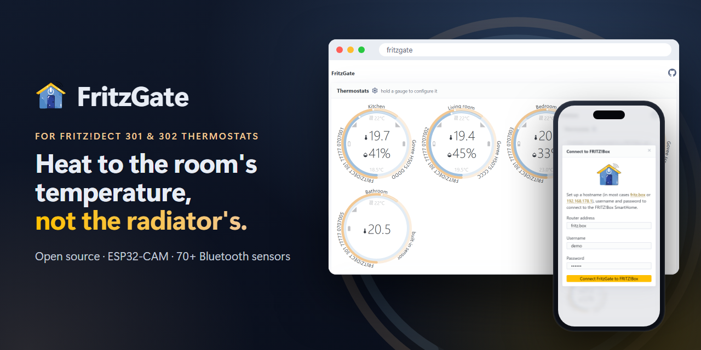

# FritzGate 
 

**FritzGate** makes your **FRITZ!DECT 301** and **FRITZ!DECT 302** radiator thermostats heat to the temperature of the room, not the temperature at the radiator. It runs on a small, inexpensive board, the **Ai Thinker ESP32-CAM**, and uses Bluetooth thermometers that you place in your rooms. Over 70 models are supported, from brands like Xiaomi, Govee, SwitchBot, Qingping, Ruuvi, Inkbird and ThermoPro.

**[Website](https://fritzgate.elebree.com/)** · **[Live demo](https://fritzgate.elebree.com/demo/)** · **[Web installer](https://fritzgate.elebree.com/flasher/)**

<a href="https://fritzgate.elebree.com/demo/">
  <picture>
    <source media="(prefers-color-scheme: dark)" srcset="site/assets/social.png">
    
  </picture>
</a>

## Why FritzGate

A radiator thermostat measures the temperature right next to the hot radiator, not in the room where you sit. Rooms get too warm, corners stay cold, and you pay for heat you never feel. With FritzGate, each thermostat follows a thermometer placed in the room, so the room reaches the temperature you set.

## What you get

- **Comfortable rooms:** The temperature you set is measured where you live, not at the radiator.
- **Your settings stay as they are:** FritzGate doesn't touch your weekly heating plans or other FRITZ!Box settings. It only changes each thermostat's *temperature offset*, a correction value that you could also set by hand in the FRITZ!Box.
- **A web page instead of an app:** Open FritzGate in any browser on your home network. It shows the temperature, humidity, battery and signal of your sensors, and lets you choose which sensor each thermostat follows. Try the [live demo](https://fritzgate.elebree.com/demo/). It simulates a FRITZ!Box, so any password connects.
- **Stays at home:** No cloud, no account and no subscription. Your FRITZ!Box login is stored only on the board.
- **Cheap and tidy:** A board and a sensor typically cost less than €20. The FRITZ!Box USB port can power the board, so you don't need an extra power supply.
- **Works without FRITZ!Box too:** Without a FRITZ!Box, FritzGate still shows the readings of your sensors.

## How it works

Every 30 seconds, FritzGate compares the temperature each thermostat measures with the temperature of the room sensor you chose for it. Then it adjusts the thermostat's offset, so that the FRITZ!Box heats until the room is warm enough. FritzGate leaves the offset alone while the heating is off or when the sensor hasn't reported for 5 minutes.

## What you need

- An **Ai Thinker ESP32-CAM** board with an **ESP32-CAM-MB** USB adapter. The board has no USB port of its own, and the two are often sold together.
- A USB data cable. Some cables only carry power and don't work for the installation.
- At least one [supported Bluetooth thermometer](#compatible-sensors).
- A **FRITZ!Box** with FRITZ!DECT 301 or 302 thermostats.
- For the installation, a computer with **Chrome** or **Edge** (Windows, macOS or Linux). Firefox, Safari and phones can't install the firmware.

## Installation

### 1. Install FritzGate on the board

1. Put the ESP32-CAM board on the MB adapter and connect it to your computer with the USB cable.
2. Open the [web installer](https://fritzgate.elebree.com/flasher/) in Chrome or Edge and click **Install FritzGate**. Choose the adapter's port, usually named CH340 or USB-SERIAL, and confirm. Installing takes a few minutes.
3. The board restarts when the installer is done. If nothing happens, press the RST button on the board.

Do you want to build FritzGate yourself or use a different tool? See [DEVELOPMENT.md](DEVELOPMENT.md).

### 2. Connect the board to your Wi-Fi

1. Power the board, for example from the USB port of your FRITZ!Box. While the board waits for Wi-Fi details, its flash LED glows dimly every two seconds.
2. Show the QR code of your Wi-Fi network to the board's camera. The FRITZ!Box user interface and most phones can show this code.
3. The board saves the Wi-Fi details and restarts. The flash LED blinks while the board connects.

The camera is only needed for this step.

### 3. Connect FritzGate to your FRITZ!Box

1. On a computer or phone in your home network, open [http://fritzgate](http://fritzgate).
2. Click **Connect to FRITZ!Box** and enter:
   - the address of your FRITZ!Box, usually `fritz.box`;
   - the user name and password of a FRITZ!Box user with the **Smart Home** permission.

   Tip: In the FRITZ!Box, create a separate user for FritzGate under **System > FRITZ!Box Users** and give it only the Smart Home permission.

To change the login later, click the gear icon next to **Thermostats**.

### 4. Choose a room sensor for each thermostat

1. Press and hold the round gauge of a thermostat until its settings open.
2. Under **Reference sensor**, select the thermometer in that room and click **Save**.

From now on, FritzGate corrects this thermostat every 30 seconds. To stop the correction, select **Built-in thermostat sensor**.

Place each thermometer where you spend time in the room, away from the radiator and direct sunlight. The board must be close enough to receive the sensors' Bluetooth signals; the web page shows the signal strength of each sensor.

## Updating

Open the [web installer](https://fritzgate.elebree.com/flasher/) again and install the latest version. Leave **Erase device** unchecked to keep your Wi-Fi, FRITZ!Box login and sensor choices.

## Troubleshooting

- **The installer can't connect to the board:** Hold the IO0 button, press and release RST, then release IO0. Click **Install FritzGate** again.
- **No port shows up in the installer:** Try another USB cable. If the port still doesn't appear, install the CH340 driver for the adapter.
- **http://fritzgate doesn't open:** Make sure your computer or phone is in the same network as the board. Try [http://fritzgate.fritz.box](http://fritzgate.fritz.box), or open the board's IP address, which the FRITZ!Box lists under **Home Network > Network**.
- **A sensor doesn't show up:** Check that it is in the [list of compatible sensors](#compatible-sensors), move the board closer and check the sensor's battery.

## Compatible Sensors

FritzGate works with Bluetooth thermometers that the open-source [Theengs Decoder](https://github.com/theengs/decoder) can read. These are some of them:

- **April Brother**: [ABN03](https://decoder.theengs.io/devices/ABN03.html), [ABN07](https://decoder.theengs.io/devices/ABN07.html), [ABTemp](https://decoder.theengs.io/devices/ABTemp.html)
- **Aranet**: [Aranet4](https://decoder.theengs.io/devices/Aranet4.html)
- **BlueMaestro**: [TD1in1](https://decoder.theengs.io/devices/BM1in1.html), [TD3in1](https://decoder.theengs.io/devices/BM3in1.html), [TD4in1](https://decoder.theengs.io/devices/BM4in1.html)
- **ClearGrass/Qingping**: [CGC1](https://decoder.theengs.io/devices/CGC1.html), [CGD1](https://decoder.theengs.io/devices/CGD1.html), [CGG1](https://decoder.theengs.io/devices/CGG1.html), [CGP1W](https://decoder.theengs.io/devices/CGP1W.html), [CGP23W](https://decoder.theengs.io/devices/CGP23W.html)
- **Govee**: [H5072](https://decoder.theengs.io/devices/H5072.html), [H5074](https://decoder.theengs.io/devices/H5074.html), [H5075](https://decoder.theengs.io/devices/H5075.html), [H5100](https://decoder.theengs.io/devices/H5100.html), [H5101](https://decoder.theengs.io/devices/H5101.html), [H5102](https://decoder.theengs.io/devices/H5102.html), [H5104](https://decoder.theengs.io/devices/H5104.html), [H5105](https://decoder.theengs.io/devices/H5105.html), [H5106](https://decoder.theengs.io/devices/H5106.html), [H5174](https://decoder.theengs.io/devices/H5174.html), [H5177](https://decoder.theengs.io/devices/H5177.html), [H5179](https://decoder.theengs.io/devices/H5179.html)
- **Inkbird**: [IBS-P01B](https://decoder.theengs.io/devices/IBS-P01B.html), [IBS-TH1](https://decoder.theengs.io/devices/IBS_TH1.html), [IBS-TH2](https://decoder.theengs.io/devices/IBS_TH2.html), [IBT_2X(S)](https://decoder.theengs.io/devices/IBT_2X.html), [IBT_4X(S/C)](https://decoder.theengs.io/devices/IBT_4XS.html), [IBT_6X(S)](https://decoder.theengs.io/devices/IBT_6XS.html), [ITH-12S](https://decoder.theengs.io/devices/ITH_12S.html)
- **Jaalee**: [F525/F51C](https://decoder.theengs.io/devices/JAALEE.html)
- **MOKOSMART**: [MBXPRO](https://decoder.theengs.io/devices/MBXPRO.html)
- **Oria/Brifit/SigmaWit/SensorPro**: [T201](https://decoder.theengs.io/devices/T201.html), [T301](https://decoder.theengs.io/devices/T301.html)
- **Qingping**: [CGDK2](https://decoder.theengs.io/devices/CGDK2.html), [CGDN1](https://decoder.theengs.io/devices/CGDN1.html)
- **rbaron**: [BPv1.0-1.2](https://decoder.theengs.io/devices/BPARASITE.html)
- **Ruuvi**: [RuuviTag](https://decoder.theengs.io/devices/RuuviTag_RAWv2.html)
- **Sensirion**: [SCD4X](https://decoder.theengs.io/devices/SCD4X.html), [SHT4X](https://decoder.theengs.io/devices/SHT4x.html)
- **SensorBlue/Oria/Brifit**: [WS02/WS08](https://decoder.theengs.io/devices/ThermoBeacon.html)
- **SwitchBot**: [Meter (Plus)](https://decoder.theengs.io/devices/SBMT.html), [Outdoor Meter](https://decoder.theengs.io/devices/SBOT.html)
- **Tenergy**: [SOLIS_6](https://decoder.theengs.io/devices/SOLIS_6.html)
- **ThermoPro**: [TP357](https://decoder.theengs.io/devices/TP357.html), [TP358](https://decoder.theengs.io/devices/TP358.html), [TP359](https://decoder.theengs.io/devices/TP359.html), [TP393](https://decoder.theengs.io/devices/TP393.html)
- **Xiaomi**: [HHCCJCY10](https://decoder.theengs.io/devices/HHCCJCY10.html), [LYWSD03MMC_ATC/PVVX](https://decoder.theengs.io/devices/LYWSD03MMC.html), [LYWSDCGQ](https://decoder.theengs.io/devices/LYWSDCGQ.html), [MHO/MMC-C401_ATC/PVVX](https://decoder.theengs.io/devices/MHO-C401.html), [MJWSD05MMC_ATC/PVVX](https://decoder.theengs.io/devices/MJWSD05MMC.html)
- **Xiaomi/Mijia**: [LYWSD02](https://decoder.theengs.io/devices/LYWSD02.html)
- **Xiaomi/VegTrug**: [HHCCJCY01HHCC](https://decoder.theengs.io/devices/HHCCJCY01HHCC.html)

Models marked *ATC/PVVX* only work with the free ATC or PVVX custom firmware. With the original Xiaomi firmware, FritzGate can't read them.

The [Theengs device list](https://decoder.theengs.io/devices/devices.html) also includes newer models, such as the Shelly BLU H&T or the Govee H5108, that FritzGate doesn't support yet.

## For Developers

To build FritzGate from source, flash it with other tools or change the code, see [DEVELOPMENT.md](DEVELOPMENT.md).

## License

FritzGate is released under the [MIT License](LICENSE).
